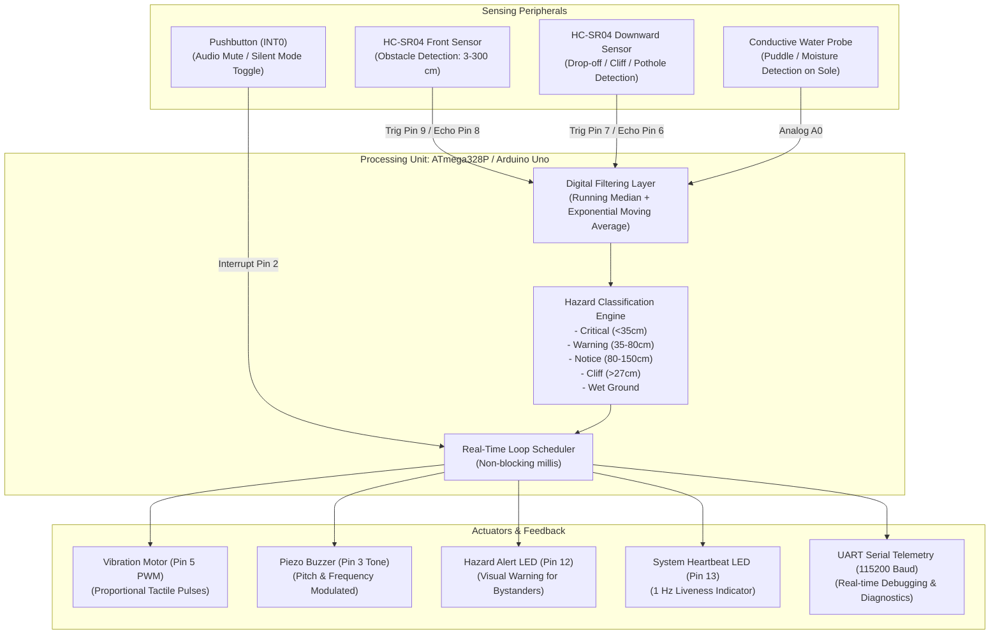
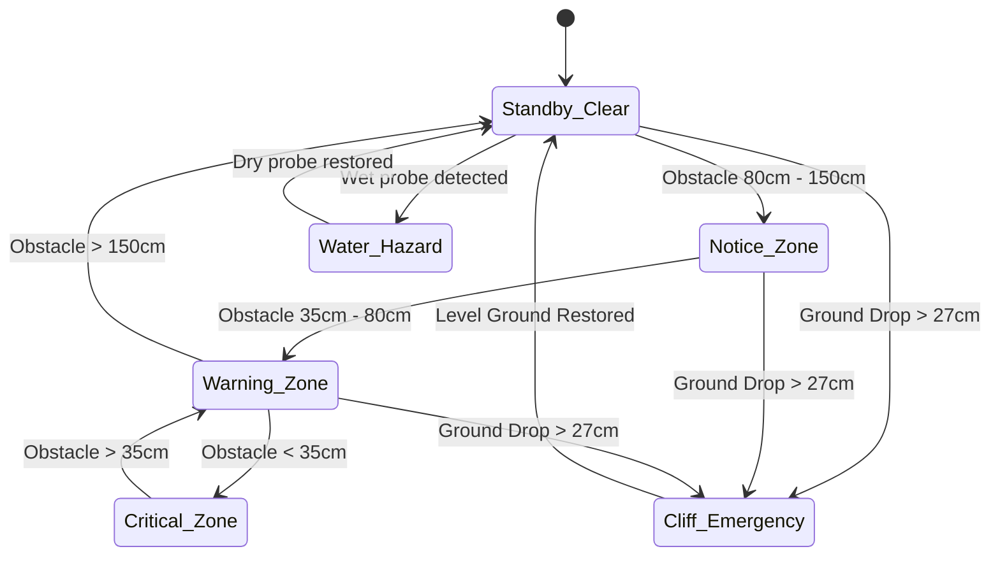

# Circuit Architecture & System Block Diagram

## High-Level System Architecture



---

## Detailed Block Diagram of Feedback States



---

## Physical Shoe Mounting Layout

```text
       =========================================================
       |                   SMART SHOE TOPOLOGY                 |
       =========================================================

                 [Front HC-SR04: Facing Forward ~5° angle]
                               /=======\
                              |  Toe    |
                              |  Cap    |
                              \=========/
                               |       |
      [Downward HC-SR04:       |       |   [Pushbutton: Tongue Collar]
       Angled 45° downward]    | Tongue|   (Audio Mute Toggle)
                               |       |
                               |-------|
                               | Ankle |   [Vibration Disc Motor]
                               | Collar|   (Direct skin contact on ankle/tongue)
                               |_______|
                               |  Heel |   [Arduino Uno / Mini + Boost + LiPo]
                               \_______/   (Embedded in heel/external shoe clip)

      ---------------------------------------------------------
      SHOE SOLE BOTTOM:
      [Interlocking Copper Trace / Rain Sensor Plate] -> Ground & A0
```
